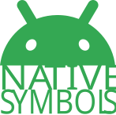

<p align="center">
  
</p>

<p align="center">
   Android 6.0+
  &nbsp;&nbsp;
   XML
  &nbsp;&nbsp;
   Kotlin
  &nbsp;&nbsp;
   Java snippets
</p>

<p align="center">
  <a href="https://play.google.com/store/apps/details?id=com.albertolicea00.nativesymbols">
    
  </a>
</p>

<p align="center">
A small, fully native Android app for exploring icons and copying the code needed to use them. It runs offline and uses Android platform UI components, with no icon library or AndroidX dependencies.
</p>


## ✨ What you can do

- 🧭 Browse all icons together or filter by **Material** and **System**.
- 🔎 Search by icon name and preview each drawable.
- 📋 Copy ready-to-use XML layout, Kotlin, and Java snippets.
- 🧩 Copy the complete vector XML for a bundled Material icon.
- 🌓 Follow the device theme or choose Light or Dark in the app. The primary color is `#34A853`.

## 🎨 Icon sources

| Catalog | Contents | How it works |
| --- | --- | --- |
| 🧩 Material | 38 bundled vector drawables | XML files stored in `app/src/main/res/drawable/` and listed from matching files in `app/src/main/assets/vectors/` |
| 🤖 System | Public `android.R.drawable` resources available on the device | Discovered at runtime; no files or icon dependency are added to the app |

The Material catalog is a bundled selection, not the entire Android Studio Vector Asset library. System icons can look different across Android versions and device themes. The app tints previews for a consistent catalog view; copied resource references use the drawable in your own app.

## 🛠️ Requirements

- Android Studio with Android SDK 36 installed
- JDK 17
- A device or emulator running Android 6.0 (API 23) or later

The project uses Gradle 8.13 through the included wrapper and Android Gradle Plugin 8.11.0. Its application ID is `com.albertolicea00.nativesymbols`.

## 🚀 Build and run

Open the repository in Android Studio, let Gradle sync, and run the **app** configuration.

From a terminal:

```bash
./gradlew :app:assembleDebug
```

The debug APK is written to `app/build/outputs/apk/debug/app-debug.apk`. On Windows, use `gradlew.bat` instead of `./gradlew`.

## 📋 Use an icon in another app

For a **Material vector**, open its detail view and copy **Vector drawable XML**. Save it in your project's `res/drawable/` directory with the resource name shown in the app. Then use one of the copied snippets, for example:

```xml
android:src="@drawable/ic_md_search"
```

```java
imageView.setImageResource(R.drawable.ic_md_search);
```

For a **System drawable**, no local file is needed:

```xml
android:src="@android:drawable/ic_menu_search"
```

```java
imageView.setImageResource(android.R.drawable.ic_menu_search);
```

The detail view also provides Kotlin equivalents and complete `ImageView` XML examples.

## ➕ Add a Material vector to this catalog

1. Add a valid Android vector drawable to `app/src/main/res/drawable/`, using a name such as `ic_md_example.xml`.
2. Put a copy with the **same filename** in `app/src/main/assets/vectors/`. The app reads this copy when you tap **Copy** for the vector XML.
3. Rebuild the app. The new icon appears automatically in the Material catalog.

Android Studio can create a vector drawable with **New → Vector Asset**. No catalog list needs to be edited.

## 🖼️ Launcher icon

`icon.svg` is the source artwork. Generated PNGs under `app/src/main/res/mipmap-*/` support older Android versions, while `mipmap-anydpi-v26/ic_launcher.xml` defines the adaptive icon for Android 8.0 and later.

After changing the SVG, regenerate the launcher assets with:

```bash
python3 tools/generate_launcher_icons.py
```

This optional asset-generation step requires `rsvg-convert` and Python's Pillow package. Neither is needed to build or run the Android app.

## 📄 Credits and license

The bundled Material vectors come from [Google's Material Design Icons repository](https://github.com/google/material-design-icons) and are licensed under [Apache License 2.0](MATERIAL_ICONS_LICENSE). Android system drawables are supplied by the operating system at runtime.
